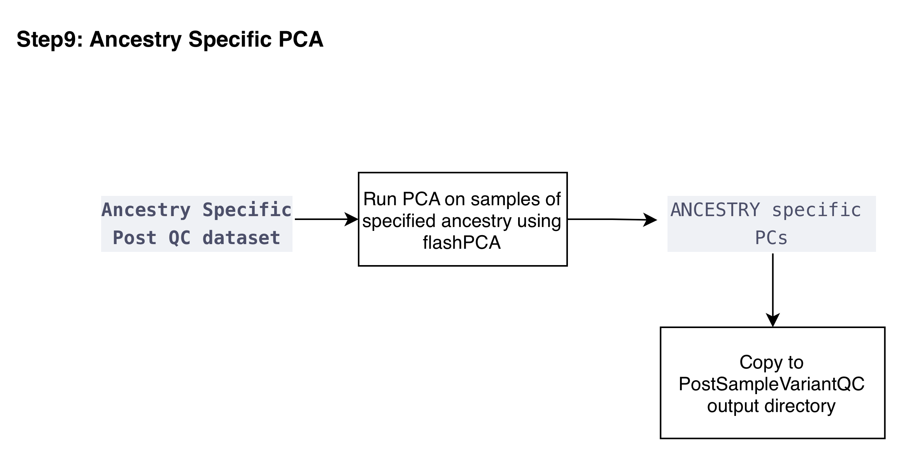

  <a href="./ind_geno_qc_step8.html">⬅️ Step 8: Finalize Outputs</a>
  <a href="./ind_geno_qc_step10.html">Step 10: Clean and Consolidate ➡️</a>

[Back to Pipeline Overview](./ind_geno_qc_detailed.html)

# Step 9: Ancestry-Specific PCA

**Script:** `Step9_AncestrySpecificPCA.sh`

---

## Process

1. **Sample count check:** Only proceed with PCA if there are at least 2 samples for the ancestry group.
2. **Ancestry-specific relatedness removal:** Within each ancestry group, filter the
   genome-wide KING `.kin0` output to pairs with kinship ≥ `pca_kinship_cutoff`
   (default 0.0625, i.e. up to 3rd-degree) and intersect with that ancestry's
   members; the same greedy/union-find selector used in Step 5 then picks a minimal
   remove-list (keeping the lowest-missingness member of each related set) →
   produces that ancestry's **unrelated subset**.
3. **LD-prune the unrelated subset:** Run `plink2 --indep-pairwise` on the ancestry's
   own unrelated subset — **this is a separate pruning pass from
   [Step 4](./ind_geno_qc_step4.html)'s pooled, genome-wide one**, done per ancestry,
   immediately before FlashPCA. Parameters (`prune_window_size`, `prune_num_snps`,
   `prune_r2_thresh`) default to the same values as Step 4 but are independently
   configurable. Below `prune_min_samples` unrelated samples (default 50), pruning is
   skipped and all candidate variants are kept instead, to avoid unstable LD
   estimates.
4. **Run FlashPCA:** Perform PCA on the unrelated, pruned subset using FlashPCA. If
   sample size is smaller than `num_pcs`, FlashPCA is automatically re-run with a
   reduced dimensionality (`allowed_dim = n_samples - 1`).
5. **Project relatives back:** Samples removed in step 2 are extracted on the pruned
   variant set and projected onto the unrelated subset's PC space via
   `flashpca --project` (using that subset's saved loadings/means/SDs), rather than
   being left out of the final PCs or included unadjusted in the PCA itself.
6. **Consolidate per-ancestry PCs:** All per-ancestry PC files (unrelated + projected
   relatives) are concatenated into a single `<study_name>_combined_ancestry_pca.tsv`
   using `stack_ancestry_pca.py`. Samples from ancestry groups where FlashPCA
   produced fewer PCs than `num_pcs` (i.e. dimension-limited runs) are **dropped**
   from the combined file — they would otherwise carry `NaN` in the extra PC columns.
7. **Copy to final output:** The combined file is copied to `PostSampleVariantQC/` alongside the other final deliverables.
8. **Output:** `<study_name>_<ancestry>_PCA.txt` (per-ancestry) and `<study_name>_combined_ancestry_pca.tsv` (all ancestries, dimension-limited samples excluded)

For a multi-batch study instead of a single study, the equivalent step is
`Step9_postimpute_AncestrySpecificPCA.sh` in the
[`multi_array_post_impute_merge`](https://github.com/giant-consortium/sample_variant_qc/tree/main/containers/multi_array_post_impute_merge#readme)
container — same algorithm, different default pruning parameters (`200 50 0.2`
instead of this pipeline's Step 4 defaults) and no R/HTML report step.

---

  <a href="./ind_geno_qc_step8.html">⬅️ Step 8: Finalize Outputs</a>
  <a href="./ind_geno_qc_step10.html">Step 10: Clean and Consolidate ➡️</a>

