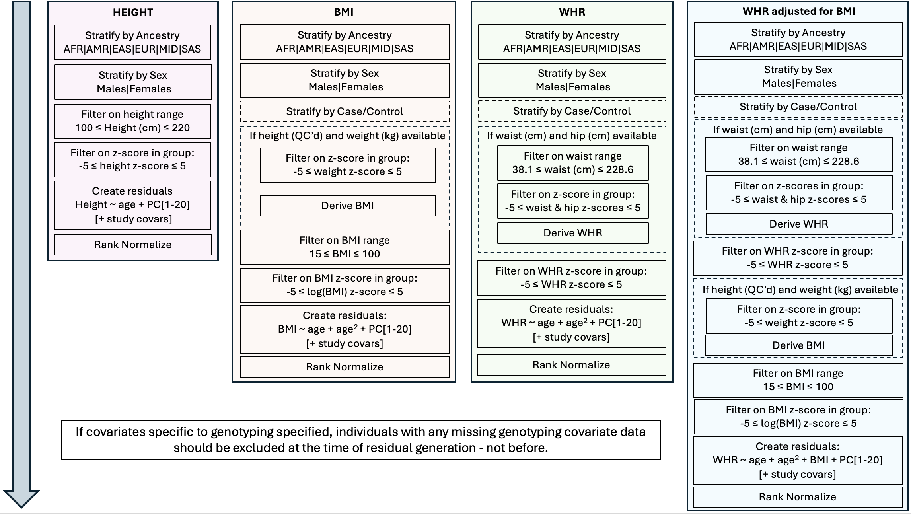

<div style="display: flex; justify-content: space-between; align-items: center;">
  <a href="./index.html">⬅️ Return to Homepage</a>
  <a href="./gwas.html">Go to Step 4 [Genome Wide Association Study] ➡️</a>
</div>

# Phenotype Pipeline

## Overview

This repository provides a containerized pipeline for QC and deriviation of phenotype data for subsequent GWAS analysis.
The dependencies for the pipeline are distributed as a .sif file that can be run using apptainer/singularity.

Typically, we expect baseline measures of anthropometric traits for analysis. However, for studies with longitudinal measures without a single baseline measure,
we suggest using the median value across the time-series. Age for the median value should either be captured or calculated.  

**Important** We request measures of weight, waist circumference, hip circumference, BMI, and/or WHR up to, and including, 2020 only. This is owing to the wide-spread introduction of GLP-1 medications. 
Please contact us if most/all of your study measures are taken post 2020.


## Usage

1. **Clone the phenotype processing repo from GitHub**

   ```
   git clone git@github.com:giant-consortium/phenotype_processing.git
   ```

2. **Navigate to `phenotype_processing/` directory**

   ```
   cd phenotype_processing/
   ```

3. **Edit `parameters.txt` to set filenames and options for your data.** This includes mapping column names to data labels that can be interpreted by the pipeline.

4. **Run the pipeline**. This will download the container if it does not already exist in the working directory.
You should specify whether you would like to use Apptainer or Singularity to run the container.

    ```
    # Run container using Apptainer
    bash PHENOTYPE_PIPELINE.sh --apptainer
    
    # Run container using Singulairty
    bash PHENOTYPE_PIPELINE.sh --singularity
    ```

5. **Outputs** will be saved in the directory specified by `out_dir` in parameters.txt. Three sub-directories will be created:

* `regenie_input/`
  * primary phenotype file
  * additional covariate file associated with genotyping / imputation process
  * subject lists to stratify individuals by ancestry and sex

* `summaries/`
  * tabular summaries of phenotypes, split by each phenotype and ancestry
  * png file plotting histograms and box plots of distributions of pre-QC'd, QC'd, residuals, and rank normal values for GWAS

* `logs/`
  * .txt files containing individuals removed due to QC of phenotype
  * .txt files containing individuals removed as missing data for phenotype or at least one covariate (including PCs) for the respective trait
  * .txt files containing individuals removed because their age at measurement is out of range
  * .txt file containing individuals removed before processing (blank ID, not in the ancestry/PCs/sexcheck files, missing ancestry label, or sexcheck `STATUS` other than `OK`)

## Details

### Overview of phenotype preparation for GWAS



### 1. Files required

The phenotype pipeline expects 3 files (plus a strongly recommended 4th) for input to be specified in the `parameters.txt` file.

| Parameter | Description |
| --- | --- |
| `pheno_cov_file` | File containing all study variables for phenotype derivation (not genotype PCs)|
| `ancestry_file`  | File containing `IID` and `Ancestry_Prediction` to map individuals to one ancestry. `Ancestry_Prediction_Confidence` may be provided as the 3rd column. Any remaining columns ignored  |
| `pcs_file`       | File containing within-ancestry genetic principal components generated by FLASHPCA |
| `sexcheck_file`  | Output from PLINK `--check-sex` (`.sexcheck`, PLINK 1.9 or 2) used to stratify by genetic sex (see below). Strongly recommended; if not provided, `sex_col` must be given |

If a file is specified but cannot be found, the pipeline stops with an error.

Note, if you have run the sample and genotype QC pipeline, you will find the ancestry file and pcs file in the `PostSampleVariantQC` sub-directory:
```
*_AncestryPredictions.txt
*_combined_ancestry_pca.tsv
```

##### Sex stratification

By default, individuals are stratified by genetic sex from `sexcheck_file`. Its `IID` column must match the IDs in `id_col`.
Only individuals with `STATUS` = `OK` (i.e. reported sex agrees with genetic sex) are kept, using `SNPSEX` (1 = male, 2 = female).
Individuals not in the file, or with any other `STATUS`, are removed and logged (see [Outputs](#outputs)). The sex check itself is not performed by this pipeline.

Only if genetic sex cannot be assessed for your study, leave `sexcheck_file` unset and instead provide `sex_col` with `m_label` and/or `f_label`.
If `sexcheck_file` is provided, these are ignored.

##### Phenotype + covariate file

This file should be a tab-delimited file with header that contains all variables for phenotype derivation for height, BMI and WHR, and all associated covariates.

```
ID    Age   Sex  Height  Weight  Waist  Hip    CatVar1  CatVar2  CatVar3
P1    25    2    99      75.6    89     100    0        1        1
P2    85    1    170     89.8    91     98     1        1        2
P3    36    2    159     91.1    84     1020   0        2        3
...
```

##### Ancestry label file - from Individual and Genotype QC Pipeline

This file should be a tab-delimited file with the header as shown with ancestry group assignment provided for each individual `[afr|amr|eas|eur|mid|sas]`

```
IID     Ancestry_Prediction
P1      eur
P2      eur
P3      eur
...
```

A third column called `Ancestry_Prediction_Confidence` may be provided to provide confidence scores (0-1) for the ancestry assignment.
If this column is provided, a second set of phenotypes will be created with only those individuals with a value >0.8 put forward for analysis.

```
IID     Ancestry_Prediction   Ancestry_Prediction_Confidence
P1      eur                   0.87
P2      eur                   0.4
P3      eur                   0.99
...
```

##### Principal components file - from Individual and Genotype QC Pipeline

This file should be a tab-delimited file with ancestry specific PCs (FLASHPCA output format)

```
IID   FID   PC1          PC2          PC3            ...    PC18         PC19         PC20
P1    1     0.722770917  0.422132091  0.516251618    ...    0.05984563   0.74798664   0.310145635
P2    2     0.584095559  0.154674118  0.243537544    ...    0.059630973  0.708644846  0.863891645
P3    3     0.709639726  0.926419979  0.041459368    ...    0.613060395  0.315596588  0.719991385
...
```

### 2. General parameters related to study

| Parameter | Description | Optional |
| --- | :--- | --- |
| `out_dir`| Parent directory for REGENIE input and summaries | No |
| `study` | Name of Study | No |
| `id_col` | Column containing individual IDs | No |
| `sex_col` | Column containing sex labels (only used if `sexcheck_file` not provided) | Yes |
| `m_label` | Label for males (only used if `sexcheck_file` not provided) | Yes |
| `f_label` | Label for females (only used if `sexcheck_file` not provided) | Yes |
| `case_col`| Column containing case/control labels | Yes |
| `case_label` | Label for disease cases | Yes |
| `control_label`| Label for disease controls | Yes |
| `qt_covar_cols` | Comma delimited QT covariate list for phenotype adjustment |Yes |
| `cat_covar_cols`| Comma delimited categorical covariate list for phenotype adjustment| Yes |
| `geno_qt_covar_cols` | Comma delimited QT covariate list for adjustment at runtime | Yes |
| `geno_cat_covar_cols` | Comma delimited categorical covariate list for adjustment at runtime | Yes |

### 3. Derivation of phenotypes

If possible, please provide variables to derive BMI and WHR, as well as any pre-derived values for BMI and WHR:

| Phenotype | Variables to include if available |
| :---: | :---: |
| **HEIGHT** | height (cm) |
| **BMI** | height (cm), weight (kg), pre-derived BMI |
| **WHR** | waist circumference (cm), hip circumference (cm), pre-derived WHR |

If variables to derive BMI and/or WHR have been provided, the pipeline will prioritise derivation of the phenotypes and only use pre-derived values (if provided) to fill any missing data where possible.
Note, derivation of BMI and WHR will include QC of variables used prior to QC of BMI and WHR. If variables are not available to derive BMI and/or WHR but variables exist with pre-derived values, these will be used.
  
#### Quality control

Variables used to derive BMI and WHR will first undergo QC prior to derivation of BMI and WHR that will subsequently be QC'd again.

Details of quality control applied to variables can be found in the following table.
Z-scores are calculated within ancestry-sex specific strata, or within ancestry-sex-case/control strata for BMI and WHR if case/control labels are provided.

| Variable / Phenotype | Range Inclusion | Z-score Inclusion |
| :---: | :---: | :---: |
| **HEIGHT**    | 100 - 220 (cm)    | -5 < z < 5 |
| **BMI**       | 15 - 100          | -5 < z(log BMI) < 5 |
| **WHR**       | NA                | -5 < z < 5 |
| **WHRadjBMI** | NA                | -5 < z < 5 |
| **WEIGHT**    | NA                | -5 < z < 5 |
| **WAIST**     | 38.1 - 228.6 (cm) | -5 < z < 5 |
| **HIP**       | NA                | NA |
| **AGE**       | 18-110 (years)    | NA |

### 4. Parameters specific to phenotypes for GWAS

To account for the nature of EHR-based studies and other longitudinal studies,
two sets of variables may be provided for BMI and WHR if the variables related to the BMI GWAS and WHR GWAS differ from those related to WHRadjBMI GWAS.
If the same variable is to be used, then you can specify the same column header for each

#### Parameters related to Height GWAS

| Parameter | Description | Optional |
| --- | --- | --- |
| `height_col` | Column containing height values (cm) | Yes |
| `age_height_col` | Column containing age at height values (years) | Yes |

#### Parameters related to BMI GWAS

We would prefer for BMI to be derived from weight and height but a parameter is provided to specify pre-derived BMI if this is not possible or to fill in missing data after derivation.

| Parameter | Description | Optional |
| --- | --- | --- |
| `weight_for_bmi_col` | Column containing weight values (kg) (used if height available) | Yes |
| `bmi_col`    | Column containing BMI values | Yes |
| `age_bmi_col` | Column containing age related to BMI (years) | Yes |

### Parameters related to WHR GWAS

We would prefer for WHR to be derived from waist and hip but a parameter is provided to specify pre-derived WHR if this is not possible or to fill in missing data after derivation.

| Parameter | Description | Optional |
| --- | --- | --- |
| `waist_for_whr_col` | Column containing waist values (cm) | Yes |
| `hip_for_whr_col`   | Column containing hip values (cm) | Yes |
| `whr_col`    | Column containing WHR values | Yes |
| `age_whr_col` | Column containing age related to WHR (years) | Yes |

### Parameters related to WHRadjBMI GWAS

We would prefer for WHR and BMI to be derived from weight, height, waist and hip, but parameters are provided to specify pre-derived WHR and/or BMI if this is not possible or to fill in missing data after derivation.

| Parameter | Description | Optional |
| --- | --- | --- |
| `waist_for_whradjbmi_col` | Column containing waist values (cm) | Yes |
| `hip_for_whradjbmi_col`   | Column containing hip values (cm) | Yes |
| `whr_col`    | Column containing WHR values | Yes |
| `weight_for_whradjbmi_col` | Column containing weight values (kg) (used if height QC'd) | Yes |
| `bmi_for_whradjbmi_col`    | Column containing BMI values | Yes |
| `age_whradjbmi__col` | Column containing age related to WHR adjusted for BMI (years) | Yes |

## Outputs

All outputs will be directed to the parent output directory specififed by the `out_dir` parameter.
Sub-directories called `broad/` and `strict/` will be created to store phenotypes for all individuals and individuals where there confidence around the ancstry label is >0.8
(if data on the confidence around estimating broad ancestry is provided in the ancestry_file file).

A table of outputs within generated sub-directories is listed below:

| Subdirectory | Files | Descroption |
| --- | --- | --- |
| `regenie_input/` | `*.pheno`  | Tab-delimited file containing phenotypes to GWAS |
| `regenie_input/` | `*.sample` | Sample lists for REGENIE to use inconjuction with the `*.pheno` file |
| `summaries/` | `*.png` | Histograms and box-plots of phenotype disributions pre- and post-QC within strata |
| `summaries/` | `*.txt` | Summaries of phenotypes and ages pre and post-QC within strata. |
| `logs/` | `*_QC_individuals_removed.txt` | List of individuals removed because of failing QC (id, value, reason). One file per QC step: `<PHENOTYPE>_QC` for the phenotype itself (e.g. `HEIGHT_QC`), and `<PHENOTYPE>_<MEASURE>_QC` for measures used to derive or adjust it (e.g. `BMI_HEIGHT_QC` for heights removed before deriving BMI) |
| `logs/` | `*_removed_missing_data.txt` | Individuals removed because of a missing value for the phenotype or at least one covariate, including any PC (tab-separated: `id`, and `missing_fields` listing the missing study data columns or PCs e.g. `PC3`, comma-separated; a column whose value was removed by QC, preventing a phenotype being derived, is marked `(failed QC)`) |
| `logs/` | `*_individuals_removed_age_out_of_range.txt` | Individuals removed from a phenotype because their age at measurement is outside the range set in `resources/scripts/giant.QCSettings.R` (tab-separated: `id`, and their age under the study data age column name e.g. `age_height`). Missing ages are logged in `*_removed_missing_data.txt` |
| `logs/` | `*_individuals_removed_ancestry_pcs_sex.txt` | Individuals in the study data file removed before any processing because they have a blank ID, are not in the `ancestry_file`, `pcs_file` or `sexcheck_file`, are missing an ancestry label, or have a sexcheck `STATUS` other than `OK` (tab-separated: `id`, and `reason` listing, comma-separated, `blank ID (line N of study data file)` with `id` left empty, `not in ancestries file`, `not in PCs file`, `not in sexcheck file`, `sexcheck STATUS PROBLEM (PEDSEX=1 SNPSEX=2)`, `Ancestry_Prediction` if the ancestry label is missing) |
